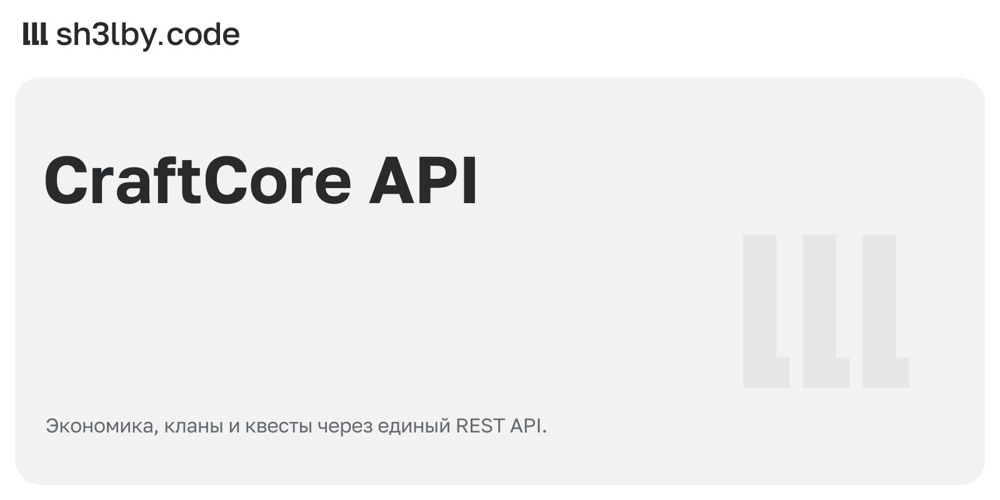

# CraftCore API

<!-- portfolio-card:start -->
[](docs/portfolio/card.svg)
<!-- portfolio-card:end -->

Игровая экономика и социальные механики, к которым обращаются разные интерфейсы. CraftCore API хранит данные и правила Minecraft-проекта; Telegram-бот, Discord-бот и плагин [CraftSocial](https://github.com/proger-exe/craftsocial) используют общий backend.

Через API доступны игроки, балансы и переводы игровой валюты, магазины с остатками, рынок, кланы, группы и квесты. Отдельные модули отвечают за рефералов, голосования, рассылки, модерацию, локализацию и пользовательские настройки.

## Где находятся правила игрового мира

Маршруты FastAPI принимают запросы, доменные менеджеры обрабатывают действия, Tortoise ORM сохраняет данные в PostgreSQL. Служебные операции используют отдельную JWT-авторизацию. Схема обновляется через стартовые миграции; запросы и ошибки записываются в структурированные логи.

В репозитории есть сценарии развёртывания через Gitea Actions и systemd. Автоматического тестового набора здесь нет; это нужно учитывать при оценке готовности конкретной интеграции.

Обсудить похожий проект: [sh3l.beer](https://sh3l.beer).

## Авторизация

- `X-Player-ID` указывает игрока, от имени которого выполняется запрос.
- Системный аккаунт `777000` для административных операций дополнительно требует `Authorization: Bearer <service JWT>`. Доверенные сервисы получают JWT через `POST /integrations/auth/token`, передавая `client_id` / `client_secret` из `SERVICE_CREDENTIALS`.

## Запуск

```bash
pip install -r requirements.txt
cp .env.example .env         # DB_*, JWT_SECRET, SERVICE_CREDENTIALS
uvicorn main:app --reload    # Swagger UI at /, ReDoc at /redoc, schema at /openapi.json
```

При первом запуске создаётся схема. Последующие изменения проходят через `core/models/startup_migrations.py`; порядок описан в `docs/DATABASE_MIGRATIONS.md`.

## Структура проекта

```
main.py                 app factory, error handlers, request log, CORS
settings.py             .env via SimpleConfig
api/routers/            admin, integrations, user (economics, localization, mailing, players, qol, safety, social)
api/schemas/            pydantic request/response models
core/models/            Tortoise models + startup migrations
core/managers/          domain logic: economics, shops, market, clans, party, quests, mailing, safety, voting, ...
core/shared/            errors, logger, helpers
docs/                   API.md (full endpoint reference), MODELS.md, SHOPS.md, TRANSFERS.md, ARRESTS.md, LOCALIZATION.md
scripts/                one-off maintenance scripts
deploy/                 deploy.sh + systemd unit
```

Автоматического тестового набора в репозитории нет. Интеграцию API с ботами и плагином нужно проверять в соответствующем окружении.

## Лицензия

MIT
